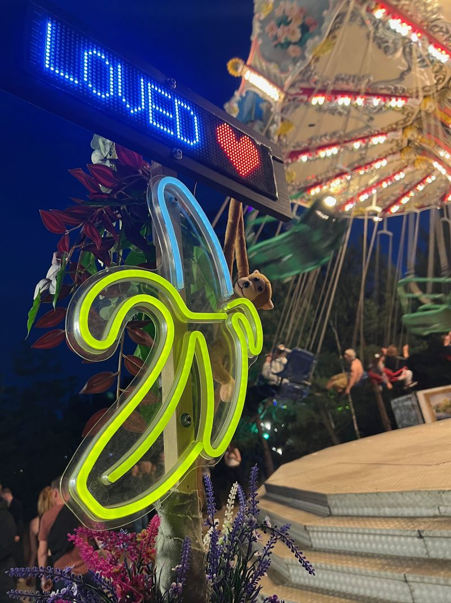

<p align="center">
  
</p>

<h1 align="center">🍌 RavestickBoard for CoolLED1248</h1>

<p align="center">
  <strong>Ein eigener ESP32-C3-Webcontroller für eine 64 × 16-Pixel-CoolLEDX-Tafel.</strong><br>
  Entstanden aus einer LED-Banane, einem Festival-Totem und dem Wunsch nach einer besseren App.
</p>

<p align="center">
  
  
  
  
  
  
</p>

<p align="center"><sub>Das Titelbild zeigt das echte Festival-Totem; der darauf sichtbare Text wurde noch mit der Original-App erstellt.</sub></p>

---

## Was ist RavestickBoard?

**RavestickBoard** ersetzt für die tägliche Bedienung der LED-Tafel die begrenzte Original-App durch ein **lokales Webinterface**, das auf einem **ESP32-C3 Super Mini** läuft. Ein iPhone, Android-Handy oder Computer verbindet sich mit dem WLAN des ESP32. Dieser überträgt die fertigen Anzeigen per **Bluetooth Low Energy (BLE)** an die CoolLEDX-Tafel.

Die Hersteller-Firmware der LED-Tafel wird dabei **nicht verändert**. Die Tafel kann hochgeladene Inhalte anschließend eigenständig darstellen. Eine Internetverbindung ist für die Bedienung nicht erforderlich.

Dieses Projekt ist ein privates, **nichtkommerzielles** Experiment für ein Festival-Totem. Es befindet sich aktiv in Entwicklung und ist noch kein fertiges Produkt.

## Aktueller Stand: v0.2.0

**Die Version v0.2.0 inklusive Kompilierkorrektur wurde am 23.10.2026 auf echter Hardware gestartet und praktisch getestet.** Der separate WebUI-Header ist Bestandteil der funktionierenden Fassung.

### Bereits umgesetzt

- **Lauftext- und Blockeditor** als getrennte Bereiche, ohne automatische Moduswahl anhand der Textlänge.
- **Bis zu zwölf individuell gestaltete Blockseiten**: hinzufügen, duplizieren, verschieben, löschen und dauerhaft speichern.
- **Pro Seite:** eine große einzeilige Engschrift oder zwei kleine Textzeilen; sieben LED-Farben, Ausrichtung und einstellbare Anzeigezeit von 5–60 Sekunden.
- **Zweizeilige Darstellung mit unterschiedlichen Zeilenfarben**, auf der echten LED-Tafel erfolgreich getestet.
- **64 × 16-LED-Vorschau** mit einzelnen runden Punkten sowie Wiedergabesteuerung einschließlich 1×, 2× und 4×.
- **Permanente Speicherung der Blockseiten auf dem ESP32** mittels NVS, auch nach Neuladen des Webinterfaces beziehungsweise Neustart.
- **Experimenteller automatischer Seitenplayer**, Diagnosebereich und BLE-Übertragung.
- **Deutsche Sonderzeichen** und eigene Pixel-Glyphen; verschiedene Formen benötigen noch Feinschliff.

### Reale Hardwaretests vom 23.10.2026

Die folgende Zusammenfassung stammt aus dem ersten systematischen Nutzer-Testprotokoll für v0.2.0. **13 von 14 Punkten wurden mit „Ja“ bestätigt**, ein Punkt war noch nicht abschließend bewertet. „Ja“ bedeutet dabei, dass die Grundfunktion läuft, nicht unbedingt, dass Darstellung und Bedienung bereits ausgereift sind.

| Testbereich | Ergebnis | Beobachtung |
| --- | --- | --- |
| ESP32-Start und Webinterface auf dem iPhone | ✅ | Funktioniert |
| Blockseiten anlegen, duplizieren, sortieren | ✅ | Funktioniert |
| Unterschiedliche Farben | ✅ | Funktioniert |
| Zweizeilige Schrift | ✅ | Gut lesbar; soll in der derzeitigen Grundform erhalten bleiben |
| Einzeilige Schrift | ⏳ | Separater Testpunkt noch offen; gewünscht ist zusätzlich „Mini, eine Zeile“, vertikal zentriert |
| Kleine Buchstaben / Unterlängen | ✅ mit Änderungsbedarf | Die kleine Schrift soll künftig **ausschließlich Großbuchstaben darstellen** |
| Umlaute und Sonderzeichen | ✅ mit Änderungsbedarf | Beim **ß** soll ein konkret markierter Pixel ausgeschaltet werden |
| Automatischer Seitenwechsel | ✅ mit Einschränkung | **Zwischen den Seiten erscheint die Prozentanzeige**, weil jede Seite neu übertragen wird |
| Individuelle Anzeigedauer | ✅ mit Einschränkung | Zeitsteuerung funktioniert, aber mit erneuter BLE-Übertragung zwischen den Seiten |
| Seiten nach Neustart weiterhin vorhanden | ✅ | NVS-Speicherung bestätigt |
| Mehrfache Übertragungen / Programmabfolge | ✅ | Im ersten Praxistest funktionsfähig |

**Wichtig:** Der Seitenplayer von v0.2.0 lädt für jeden Wechsel eine komplette Seite per BLE hoch. Die Tafel zeigt dabei ihre eigene Übertragungsfortschrittsanzeige. Dieses Verhalten ist für einen zusammenhängenden Blocktext **noch nicht die gewünschte Lösung**. Der vorhandene Code ist jedoch eine gute Grundlage für eine spätere **Playlist aus mehreren eigenständigen Programmen**.

## So funktioniert es

```text
Handy / Computer
       │
       │ WLAN: lokales Webinterface
       ▼
ESP32-C3 Super Mini
       │
       │ BLE: Steuerbefehle + Pixeldaten
       ▼
CoolLEDX / CoolLED1248
64 × 16 Pixel · 7 LED-Farben
```

Die Hardware unterscheidet bereits zwischen **Inhaltsübertragungen** und kurzen **Steuerbefehlen**. Helligkeit (`0x08`), Laufgeschwindigkeit (`0x07`) und Anzeigemodus (`0x06`) lassen sich prinzipiell separat steuern. Live-Regler und die vollständige Modusauswahl sind für kommende Versionen vorgesehen.

### Geplante Architektur

- **Seite:** Individuell gestaltete Anzeige mit Text, Schrift, Farben, Positionierung und gegebenenfalls Dauer.
- **Programm:** Eine oder mehrere Seiten, die idealerweise **mit einer Übertragung** auf die Tafel gelangen und anschließend autonom ablaufen.
- **Playlist:** Eine Abfolge mehrerer Programme, deren Wechsel der ESP32 steuert. Dabei sind neue BLE-Uploads akzeptabel.

Ob unsere konkrete Tafel mehrseitige Inhalte oder eigene Animationen über den dokumentierten Animationsbefehl `0x04` selbstständig abspielen kann, ist **noch nicht auf unserer Hardware verifiziert**. Das ist ein wichtiges nächstes Forschungsthema.

## Installation und erste Verbindung

**Benötigt:** ESP32-C3 Super Mini, kompatible CoolLEDX-Tafel (hier 64 × 16 Pixel, sieben Farben), USB-Kabel und Arduino IDE mit dem Espressif-Boardpaket.

1. `firmware/RavestickBoard_v0_2_0/RavestickBoard_v0_2_0.ino` in der Arduino IDE öffnen.
2. Sicherstellen, dass **`RavestickBoard_WebUI.h` im selben Ordner** wie die `.ino` liegt. Ohne diese Datei ist die v0.2.0-Korrekturfassung nicht vollständig.
3. Das Board **`ESP32C3 Dev Module`** auswählen und **`USB CDC On Boot: Enabled`** setzen.
4. Die Partitionierung **`No OTA (2MB APP/2MB SPIFFS)`** auswählen. Getestete Entwicklungsumgebung: Arduino IDE 2.3.10, `esp32` von Espressif 3.3.12.
5. Über USB auf den ESP32 flashen. **OTA-Firmwareupdates sind nicht vorgesehen.**
6. Handy oder Computer mit dem vom ESP32 erzeugten WLAN **`CoolLED1248`** verbinden. Das derzeit im Sketch hinterlegte WLAN-Passwort ist bewusst öffentlich dokumentiert. Es ist kein Geheimnis; Personen in Funkreichweite könnten damit das Geräte-WLAN verwenden. Eine individuelle Passwortkonfiguration im Webinterface ist für eine spätere Version vorgesehen.
7. Die lokale Seite **[http://192.168.4.1](http://192.168.4.1)** öffnen. Der Browser benötigt keine Internetverbindung.
8. Zunächst eine Blockseite **einzeln** übertragen; erst danach die experimentelle automatische Wiedergabe ausprobieren.

> **Hinweis:** Die BLE-Adresse der bisher verwendeten Tafel ist in der Firmware noch fest hinterlegt. Eine automatische Gerätesuche und Unterstützung mehrerer Boards sind geplant. Während die Original-App die BLE-Verbindung zur Tafel hält, kann RavestickBoard unter Umständen nicht gleichzeitig übertragen.

## Bekannte Grenzen und nächste Schritte

| Thema | Stand |
| --- | --- |
| **Blockprogramm ohne Prozentanzeige** | Offen: Seiten sollen als **ein Programm** übertragen werden; Animations- und native Blockmodi untersuchen |
| **Minischrift** | Zweizeilig bestätigt; Kleinbuchstaben künftig automatisch als Großbuchstaben darstellen; einzeilige Mini-Variante ergänzen |
| **Schrift-Feinschliff** | `g`, `p`, `q`, `y` an x-Höhe/Unterlängen anpassen; `ß`/`ẞ` mit eigener Pixelkorrektur; Originalfonts Normal und Bold rekonstruieren |
| **Live-Steuerung** | Helligkeit, Tempo und Anzeigemodus ohne vollständigen Neu-Upload direkt an die Tafel senden |
| **Bibliothek** | Benannte Text- und Seitenprogramme, Entwürfe automatisch wiederherstellen, später Export/Import und Favoriten |
| **Individuelle Gestaltung** | Farben und Schriftarten pro Zeichen/Abschnitt, frei platzierbare Elemente, Grafiken und Übergänge |
| **Eigene Animationen** | `0x04` und Speichergrenzen auf dem konkreten Board experimentell überprüfen |
| **Weitere Programme** | Countdown, Stoppuhr, Scoreboard, Lichtfunktion, Playlist und acht Schnellzugriffe |

Weitere Ideen, Entscheidungen und offene Aufgaben werden unter [`docs/THEMENSPEICHER.md`](docs/THEMENSPEICHER.md) sowie [`docs/ROADMAP.md`](docs/ROADMAP.md) gesammelt. Änderungen und Teststände stehen in [`CHANGELOG.md`](CHANGELOG.md).

## Referenzen, Credits und Lizenzsituation

RavestickBoard baut auf eigenen Hardwaretests und öffentlich dokumentierten Erkenntnissen zum CoolLEDX-BLE-Protokoll auf. Wertvolle Referenzen sind insbesondere:

- [UpDryTwist/coolledx-driver](https://github.com/UpDryTwist/coolledx-driver) (MIT-lizenziertes Referenzprojekt).
- [schulzad/coolled-sign-controller / OpenSign](https://github.com/schulzad/coolled-sign-controller) (wichtige Protokollforschung und Animationsexperimente; **derzeit ohne Freigabelizenz für die Übernahme des Quellcodes**).
- [ohtaras/led](https://github.com/ohtaras/led) (Protokollreferenz; gesonderte Lizenzprüfung vor einer etwaigen Codeübernahme).

**RavestickBoard ist öffentlich einsehbar, aber derzeit nicht unter einer Open-Source-Lizenz freigegeben.** Es gilt der Copyright- und Nutzungshinweis in [`LICENSE`](LICENSE) (All Rights Reserved). Sichtbarkeit, Dokumentation und technische Diskussion sind erwünscht; daraus entsteht keine allgemeine Erlaubnis zum Kopieren, Bearbeiten oder Weiterverbreiten des eigenen Projektcodes. GitHubs Nutzungsbedingungen und gesetzliche Rechte bleiben unberührt.

Nichtkommerzieller Einsatz allein ersetzt keine Nutzungsrechte an fremdem Code. Insbesondere übernehmen wir OpenSign-Code ohne Erlaubnis **nicht** und portieren ihn nicht einfach nach C++. Die Quellcodeherkunft und die Abgrenzung dokumentierter Protokolldaten von fremder Software dokumentiert [`docs/QUELLEN_UND_LIZENZEN.md`](docs/QUELLEN_UND_LIZENZEN.md).

---

<p align="center">
  <strong>Made for the rave, powered by a banana. 🍌</strong><br>
  <sub>RavestickBoard is an independent hobby project, not affiliated with the CoolLED1248 manufacturer.</sub>
</p>
