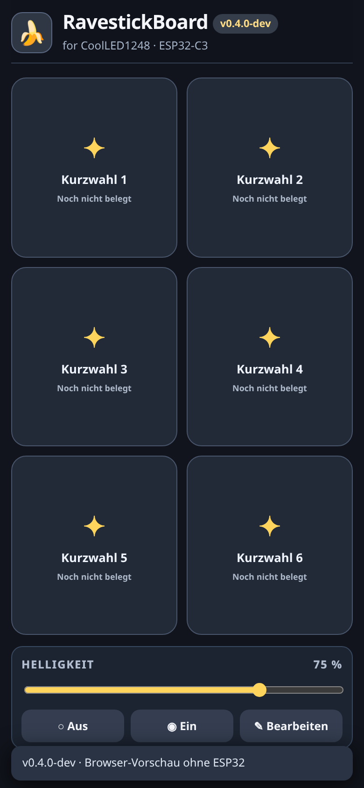

## v0.4.1-dev (27.10.2026) – Bibliothek im ESP32-Flash 🍌

**Neue Testversion, noch nicht auf der CoolLEDX-Hardware bestätigt.** Aufbauend auf der
auf realer Hardware getesteten v0.4.0.3-dev mit RAM-Streaming (8-Stunden-Leerlauf-/Stabilitätstest).

- Bis zu **64 dauerhaft gespeicherte Lauftexte** auf dem ESP32 über LittleFS; 1.599 UTF-8-Bytes je Textzeile, maximal 47 UTF-8-Bytes für den Namen. Fonts (5 Layouts), beide Farben, ein Modus (Stand/Lauf) und Favorit bleiben pro Datensatz erhalten. Das reale 30-KiB-LED-Budget gilt weiterhin.
- **Gemeinsame Bibliothek** im WLAN des ESP32 statt nur im lokalen Smartphone-Browser: öffnen, aus dem Editor neu speichern oder aktualisieren, duplizieren, umbenennen, löschen, Favorit markieren und sortieren (Desktop Drag & Drop, mobil mit Pfeilen).
- **Sechs frei belegbare Kurzwahltasten** auf der Startseite. Antippen überträgt den jeweiligen gespeicherten Text per bewährtem BLE-Auftrag. Belegungen überleben einen Neustart; Löschen eines verwendeten Textes ist gesperrt.
- **JSON-Backup/Import** über den Browser. Import fügt Einträge hinzu, vergibt neue stabile IDs und übernimmt Backup-Kurzwahlen ausschließlich in bisher freie Felder. Import ist nicht atomar: Einträge, die vor einem Fehler schon gespeichert wurden, bleiben erhalten.
- Flash-Datenformat: versionierte, prüfsummengesicherte Einträge und zwei abwechselnde Metadaten-Journaldateien; beim Aktualisieren vorübergehend eine Rückfallkopie. Maximal ein begrenzter Datensatz im RAM, keine komplette Bibliothek.
- **Sicherheitsentscheidung:** kein automatisches LittleFS-Format bei einem Fehler. Bei frischer Partition muss die Ersteinrichtung auf der Bibliotheksseite ausdrücklich bestätigt werden. Wenn Metadaten beschädigt sind, erfolgt kein automatisches Löschen.
- Die **zwölf bestehenden Blockseiten bleiben binär unverändert in NVS**. Der Streaming-Renderer, RAMTRACE, BLE-Protokoll und alle bisherigen Pixelart-Sprite-IDs sind übernommen. Programme aus mehreren Bibliothekstexten bleiben für v0.4.2 vorgesehen.

**Installation und Test:** [`docs/INSTALLATION_v0.4.1.md`](docs/INSTALLATION_v0.4.1.md),
[`docs/TESTPLAN_v0.4.1.md`](docs/TESTPLAN_v0.4.1.md) und
[`docs/BIBLIOTHEK_v0.4.1.md`](docs/BIBLIOTHEK_v0.4.1.md).

---

<p align="center">
  
</p>

<p align="center">
  
</p>

<h1 align="center">🍌 RavestickBoard for CoolLED1248</h1>

<p align="center">
  <strong>Unsere freie, lokal betriebene Websteuerung für eine 64 × 16-CoolLEDX-Tafel.</strong><br>
  Entstanden aus einer Festival-Banane, einer ungewöhnlich liebgewonnenen Original-App und dem Wunsch, deutlich mehr aus 1.024 LEDs herauszuholen.
</p>

<p align="center">
  
  
  
  
  
</p>

<p align="center">
  
</p>

> **Entwicklungsstand vom 27. Oktober 2026:** **v0.4.0.1-dev** wurde auf dem ESP32-C3 erfolgreich kompiliert und in **20 von 21 Testpunkten** als OK bewertet; ein erster Diagnoselog zeigte **324 B historischen Minimal-Heap**, ein weiterer unter anderer Belastung **48.108 B**, ein großer 30.713-B-Upload **11.052 B**. Diese unterschiedlichen, nicht gleichzeitig beobachteten Tiefstwerte erfordern eine gezielte Analyse. **v0.4.0.2-dev** ergänzt dafür eine RAM-Verlaufsdiagnose und übernimmt die neueste Pixelart-Excel. **v0.4.0.2 ist noch nicht kompiliert oder auf der Hardware getestet.** Die Bibliothek und Programme bleiben vorerst vorbereitete Ansichten.

## 🍌 v0.4.0.3-dev — Speicheroptimierung (Hardwaretest offen)

**Neuer experimenteller Firmwarestand:** 64-Spalten-Kachelrenderer für große Lauftexte (ab 8 KiB Bildpayload, 384 B Tile statt bis zu 30 KiB dynamischem Vollbild), einmaliger BLE-MTU-Recovery-Versuch bei ungültiger MTU und jobbezogene RAMTRACE-Minima. Die WebUX und Symbolsammlung bleiben gleich. Hostseitige C++-Differenztests bestätigten bytegleiche Bilddaten in 135 Fällen; Arduino-Kompilierung und echter Hardwaretest stehen noch aus. Siehe [RAM-Optimierung](docs/RAM_OPTIMIERUNG_v0.4.0.3.md), [Installation](docs/INSTALLATION_v0.4.0.3.md) und [Testplan](docs/TESTPLAN_v0.4.0.3.md).

## Worum geht es?

Wir ersetzen die umständliche tägliche Bedienung der CoolLED1248-App durch eine eigene, mobilefreundliche Webanwendung. Unser **ESP32-C3 Super Mini** stellt ein WLAN bereit und überträgt LED-Inhalte über **Bluetooth Low Energy (BLE)** an eine vorhandene **CoolLEDX-Tafel mit 64 × 16 Pixeln**.

```text
Smartphone / Notebook
        │ WLAN „CoolLED1248“
        ▼
ESP32-C3 mit RavestickBoard-Webinterface
        │ BLE: FFF0/FFF1
        ▼
CoolLEDX LED-Tafel (64 × 16, sieben LED-Farben)
```

Die Hersteller-Firmware der Tafel bleibt unverändert. Für das lokale Steuern brauchen wir weder Cloud noch Internet. Das Projekt ist aus unserem Festival-Totem entstanden; wir entwickeln es offen weiter, dokumentieren auch Sackgassen und testen die Änderungen möglichst auf echter Hardware.

## Was funktioniert schon?

Unsere **auf realer Hardware bestätigte Basis v0.4.0** (aufbauend auf v0.3.5.1) bietet:

- **Texte übertragen:** linkslaufender Text mit datenbasierter Längenprüfung; die experimentell gesetzte Obergrenze beträgt 30 KiB Bilddaten. Im Hardwaretest der Vorgängerfassung wurden 650 Zeichen bei 30.689 Byte erfolgreich übertragen und dargestellt.
- **Schriften:** Original Normal, Original Bold, Engschrift, Mini Einzeilig und Mini Zweizeilig. Im zweizeiligen Lauftext können die beiden Zeilen verschiedene Farben haben.
- **Pixelgrafiken:** In v0.4.0 waren 36 16×16-Symbole enthalten; **v0.4.0.2-dev enthält intern 64 Motive** (einschließlich 28 zusätzlicher Excel-Grafiken; sechs verworfene Warnvarianten bleiben aus Kompatibilitätsgründen nur intern reserviert). Die neue Krabbe ersetzt die bisherige Grafik unter derselben ID; die neue Schneeflocke kommt separat hinzu. Alle sieben Herzfarben bleiben erhalten.
- **Blockseiten:** Einzelne Seiten gestalten, speichern und manuell anzeigen; bis zu zwölf Seiten in der bestehenden NVS-Struktur. Eine einfache ESP32-gesteuerte Wiedergabe ist vorhanden und erfordert weiterhin neue BLE-Bildübertragungen zwischen den Seiten.
- **Live-Steuerung:** Helligkeit, Tempo, acht Anzeigeeffekte sowie Ein/Aus per BLE, ohne dafür jeweils ein neues Bild hochzuladen. Die tatsächlich sichtbare Wirkung wurde im Projekt getestet; BLE-Quittungen allein sind kein Bildnachweis.
- **Diagnose:** Status, BLE-Zähler, Fehlermeldungen und Ereignisse; TXT-Export ohne gespeicherte Texte, Passwörter oder Geräteadressen.

### v0.4.0.2-dev: RAM-Verlaufsdiagnose und aktuelle Pixelart

Dieser **Diagnose-Testbuild** enthält keine neue Bibliotheksarchitektur. Stattdessen messen wir gezielt, wann die RAM-Reserve absinkt:

- **RAMTRACE** mit Zeitstempel, Jobnummer, Jobtyp, WLAN-Clients, freiem Heap, ESP32-System-Tiefstwert und größtem zusammenhängendem Block. Messpunkte: beim Booten, während des Webabrufs, vor/nach Rendern und Pufferreservierung, BLE-Verbindungsaufbau, alle 32 BLE-Pakete beziehungsweise beim neuen gemessenen Tiefstwert, vor und nach Freigabe sowie am Jobende.
- **Diagnose-Seite:** zusätzliche Schaltfläche **„RAM-Verlauf TXT“**, erreichbar auch direkt unter `/api/ram.txt`. Das vorhandene Standard-Diagnose-TXT erhält die wichtigsten RAMTRACE-Minima. Der Ringpuffer wird nicht in NVS geschrieben und belegt statisch ca. 1,5 KiB RAM.
- **Pixelart aus aktueller GitHub-Excel:** 36 Quelldatensätze; kleine Korrekturen an Frosch, Zigarette, Joint und Verbotssymbolen, neue **Ziggi II** als eigenes Motiv. Die sechs verworfenen farbigen Warnungen werden im Picker nicht mehr angeboten. Ihre IDs und bisherigen Bitmaps bleiben erhalten, damit gespeicherte Texte nicht versehentlich verändert werden.
- **Original-Banane bleibt unverändert:** Das Excel-Bananenmotiv weicht bereits stark von der bisherigen Original-Banane unter ID 14 ab; ohne ausdrücklichen Austausch behalten wir sie aus Gründen der Kompatibilität. Die eigene Ravestick-Banane bleibt ebenfalls unverändert.
- **Unverändert:** BLE-Kommandos, NVS-Schema, zwölf Blockseiten, globale Helligkeit/Tempo, 30-KiB-Bildlimit und die bisherige Editor-UX. Noch keine LittleFS-Bibliothek.

**Teststatus v0.4.0.2:** Statische Checks vorgesehen/durchgeführt; Arduino-Kompilierung und Hardwaretest müssen nach dem Flashen bestätigt werden. Siehe [`RAM_DIAGNOSE_v0.4.0.2.md`](docs/RAM_DIAGNOSE_v0.4.0.2.md), [Testplan](docs/TESTPLAN_v0.4.0.2.md) und [Symbolregister](docs/PIXELART_REGISTER_v0.4.0.2.json).

### v0.4.0.1-dev: WebUX-Feinschliff und Pixelart

Wir haben nach dem erfolgreichen v0.4.0-Hardwaretest die Bedienung gezielt verfeinert:

- **Kurzwahl ist dauerhaft der erste Menüpunkt**, danach folgen Texteditor, Bibliothek, Programme, Ambiente, Diagnose und Einstellungen. Der Bananen-Button bleibt auf jeder Seite verfügbar.
- **Bibliothek und Programme nutzen fast die gesamte verfügbare Höhe für ihre scrollbaren Listen**; die festen oberen Aktionen und unteren Geräteeinstellungen sind kompakter.
- **Helligkeit und Tempo:** keine separaten Überschriften mehr, sondern eigene monochrome 16×16-Piktogramme (kleine/große Glühlampe beziehungsweise Schnecke/Pferd). Die Werte bleiben global und geräteweit synchron.
- **Statusmeldungen:** kein permanenter Hinweisfuß mehr; normale Meldungen verschwinden nach etwa 2,7 Sekunden. Fehler bleiben bis zum Antippen sichtbar. Unbelegte Kurzwahlen geben nur ein kurzes visuelles Feedback.
- **Symbol-Picker:** 63 originale und eigene Motive in **einer thematischen Sammlung**, mit ihren tatsächlichen 16×16-Pixelgrafiken auf den Schaltflächen. Alien bei den UFOs; neue Krabbe ersetzt die alte, zweite Schneeflocke bleibt zusätzlich.
- **Unverändert:** BLE-Steuerprotokoll, dynamisches 30-KiB-Datenbudget, NVS-Schema und bestehende Blockseiten. Die Firmware v0.4.0 bleibt als Rückfalloption erhalten.

Die **35 Ausgangsmotive von v0.4.0.1** stammen aus der damals verwendeten Datei [`docs/assets/Pixel-Art.xlsx`](docs/assets/Pixel-Art.xlsx) und sind als [Symbolregister](docs/PIXELART_REGISTER_v0.4.0.1.json) mit Quellzuordnung und Pixel-Prüfsummen nachgewiesen. Die Vorschau steht unter [`docs/assets/pixelart-v0.4.0.1.png`](docs/assets/pixelart-v0.4.0.1.png). **Der Frosch bleibt vorerst unverändert; seine gestalterische Überarbeitung ist noch offen.**

**Teststatus v0.4.0.1:** Chromium-/JavaScript-Prüfung erfolgreich, anschließend Arduino-Kompilierung und **20 von 21** Funktionstests auf realer Hardware OK. Der Datenexport nach 33:09 Minuten zeigt stabile BLE-Jobs, aber ein sehr niedriges historisches Heap-Minimum; genaue Ursache wird nun mit v0.4.0.2 untersucht.

### Grundlage: v0.4.0-dev

| Bereich | Stand dieser Version | Was folgt später? |
| --- | --- | --- |
| Kurzwahl | Sechs große Kurzwahl-Kacheln; Bearbeiten-Modus visuell vorbereitet; Helligkeit und Ein/Aus bedienbar | Echte Kachelbelegung aus der Bibliothek |
| Navigation | Bananen-Button öffnet das Menü; sieben getrennte Bereiche; Header auf jeder Seite | – |
| Bibliothek | Layout mit fester Aktionsleiste, Liste, globalen Reglern und Modusauswahl | Anlegen, Auswahl, Drag-and-drop, Löschen, Übertragen (**v0.4.1**) |
| Programme | Eigenständige Ansicht und Bedienstruktur | Referenzbasierte Verkettung und Größenprüfung (**v0.4.2**) |
| Texteditor | Vorhandene Lauftext- und Blockseitenfunktionen bleiben erreichbar | Individuelle Farbgebung innerhalb eines Textes (**v0.4.3**, geplant) |
| Symbol-Picker | **63 echte 16×16-Bildvorschauen** inklusive vollständiger neuer Excel-Sammlung; Öffnen mit Herz ♥ | Optional neue Motive |
| Ambiente | Sieben große Farbtasten; jedes Tippen sendet ein vollständig einfarbiges 64×16-Bild | In v0.4.0 hardwarebestätigt |
| Diagnose | Eigene Seite statt Fußbereich im Editor | Weitere Diagnosewerkzeuge |
| Einstellungen | Eigene Seite, aktueller Geräteanschluss beschrieben | BLE-Suche und Wechsel zwischen Tafeln |

**Bewusst noch nicht implementiert:** Persistente Bibliothek, echte gespeicherte Kurzwahlbelegung, Drag-and-drop und neue Mehrseiten-Programme. Die vorhandene **NVS-Blockseitenverwaltung im Editor bleibt bestehen**; wir nennen sie nicht vorzeitig die neue Bibliothek.

## Unsere Bedienlogik

### Startbildschirm: unmittelbar steuern

Die sechs Kacheln sind in einem 2×3-Raster angeordnet. Die Seite heißt jetzt **Kurzwahl** und steht immer als erster Menüpunkt zur Verfügung. Die Seite ist für einen Smartphonebildschirm ohne vertikales Scrollen ausgelegt. Helligkeit und Ein/Aus sind direkt erreichbar. Im derzeitigen Entwicklungsstand sind die sechs Kacheln bewusst *nicht belegt*; nach dem Aktivieren des Bearbeiten-Modus verweist die Oberfläche auf die noch ausstehende Bibliothek.

### Bibliothek und Programme: unterschiedliche Aufgaben

In der **Bibliothek** speichern wir künftig einzelne Texte mit Schrift, Farbe, Symbolen und ihrem jeweiligen Anzeigemodus. Die **Programme** verknüpfen diese Texte anhand stabiler Referenzen. Ändern wir später einen Bibliothekstext, wirken sich die Änderungen automatisch auf die Programme aus, die diesen Text verwenden. Beim Löschen werden wir referenzierende Programme berücksichtigen und vor Schäden warnen.

Sortieren soll per **Drag-and-drop** funktionieren, auch auf dem Smartphone. Die Bibliotheksansicht bekommt oben die Aktionen *Editor, Löschen, Sortieren, Übertragen*; die Programmverwaltung *Neu, Löschen, Sortieren, Übertragen*. Unten befinden sich die globalen Regler und der aktuelle Modus-Override.

### Globales Tempo und globale Helligkeit

Helligkeit und Geschwindigkeit gehören **zur Tafel, nicht zu einem gespeicherten Text**. Wir führen sie über alle relevanten Ansichten synchron. Ein Textwechsel darf diese beiden Werte nicht ungefragt ändern. In v0.4.0 lassen wir den gesamten Geschwindigkeitsbereich **1–100** zu (Standard 80); die Roh-BLE-Kennlinie bleibt vorerst unverändert und ist nicht mit der Hersteller-App kalibriert.

Der **Anzeigemodus** ist dagegen in unserer künftigen Bibliothek ein Bestandteil jedes Textes. Der Modus-Override unten in Bibliothek beziehungsweise Programme steuert die **aktuelle** Anzeige. Ein neu gestarteter Text setzt wieder seinen eigenen Modus. Die alten Blockseiten bleiben Standbilder.

### Pixelgrafiken statt Unicode-Vorschaubildern

Unser Symbol-Picker verwendet die vorhandenen Pixelmatrizen direkt. Das sichtbare 16×16-Motiv entspricht damit der Grundlage des späteren LED-Renders. Die Herkunft (Hersteller-Screenshot oder eigene Pixelart) spielt für die Bedienung keine Rolle; die Quellen dokumentieren wir separat. Die Symbole sind thematisch sortiert, nicht nach Herkunft.

Wir pflegen weitere Motive in der Excel-Sammlung `docs/assets/Pixel-Art.xlsx` im Repository. **Seit v0.4.0.1-dev sind die Excel-Motive importiert und in Webvorschau und Firmware synchron.** Die von uns neu gezeichnete Krabbe soll die alte Krabbe ersetzen, während die zusätzliche Schneeflocke als eigene Variante erhalten bleibt. Der Frosch wartet weiterhin auf seine Überarbeitung.

## Installation / erster Test

### Voraussetzungen

- ESP32-C3 Super Mini / ESP32C3 Dev Module und passende USB-Datenverbindung.
- Arduino IDE mit ESP32-Boardpaket und den durch Arduino-ESP32 bereitgestellten Bibliotheken `WiFi`, `WebServer`, `Preferences` und BLE-Unterstützung.
- CoolLEDX-Tafel mit 64 × 16 Pixeln; die Firmware ist derzeit auf die **bekannte BLE-Adresse einer Testtafel** ausgerichtet und scannt noch nicht selbst nach anderen Boards.
- Zum Flashen: Boardprofil **ESP32C3 Dev Module**, USB CDC On Boot aktiviert und Partitionierung **No OTA (2MB APP / 2MB SPIFFS)**; mit dieser Einstellung haben wir den bisherigen Sketch getestet. v0.4.0 wurde erfolgreich kompiliert; v0.4.0.1-dev ist noch nicht mit der Arduino IDE kompiliert.

### Flashen

1. Das Versionspaket in die **Wurzel des lokalen Git-Repositories** entpacken. Bestehende Versionsordner bleiben als Rückfalloption erhalten.
2. In der Arduino IDE `firmware/RavestickBoard_v0_4_0_1/RavestickBoard_v0_4_0_1.ino` öffnen. Die beiden `.h`-Dateien müssen **im gleichen Ordner** liegen.
3. Board-/Port-Einstellungen wie bei v0.3.5.1 wählen. **„Erase All Flash“ nicht aktivieren.** Wir behalten das bestehende NVS-Schema bei, damit gespeicherte Blockseiten erhalten bleiben.
4. Flashen, das Smartphone mit **`CoolLED1248`** verbinden und **`http://192.168.4.1`** öffnen. Das vorhandene Demo-WLAN-Passwort steht im Firmwarequelltext; vor dem Einsatz in einer fremden Umgebung bitte anpassen.
5. Erst Navigation, gespeicherte Blockseiten und die vertrauten BLE-Funktionen testen; anschließend Ambiente und globale Regler prüfen. Nach jedem Hardwaretest den Diagnoselog sichern.

**Wichtig:** v0.4.0.1 nicht allein aufgrund bestandener Browser- und JavaScript-Tests als hardwarebestätigt betrachten. Bei Problemen können wir v0.3.5.1 aus ihrem eigenen Sketchordner flashen. Das Update führt keine NVS-Migration durch.

## Projektstruktur

```text
RavestickBoard-for-CoolLED1248/
├── README.md                         Projektübersicht, Aufbau und Bedienung
├── LICENSE                           MIT für unsere lizenzierbaren Codebestandteile
├── CHANGELOG.md                      Versionen und nachprüfbarer Teststatus
├── docs/
│   ├── ENTWICKLUNGSSTAND_v0.4.0.1_2026-10-26.md
│   ├── ENTWICKLUNGSSTAND_v0.4.0_2026-10-26.md
│   ├── TESTPLAN_v0.4.0.1.md
│   ├── TESTPLAN_v0.4.0.md
│   ├── QUELLEN_UND_LIZENZEN.md       Rechte und externe Referenzen
│   ├── ROADMAP.md                    Entwicklungsschritte
│   ├── THEMENSPEICHER.md             Ideen, auch ohne Umsetzungszusage
│   └── assets/                       Totemfotos, GIF, UI-Bild, Pixelart-Excel
├── firmware/
│   ├── RavestickBoard_v0_3_5_1/     Hardwaregetesteter Rückfallstand
│   ├── RavestickBoard_v0_4_0/       Hardwarebestätigter Rückfallstand
│   └── RavestickBoard_v0_4_0_1/     WebUX-Feinschliff + neue Pixelassets
└── web/index.html                    Bearbeitbare Weboberfläche (Quelle)
```

Die Datei `firmware/RavestickBoard_v0_4_0_1/RavestickBoard_WebUI.h` bettet die aktuelle `web/index.html` für den ESP32 ein. **Beide Versionen müssen synchron bleiben.** Die vielen alten Sketchordner sind gewollt: Wir archivieren Meilensteine, statt stabile Stände kommentarlos zu überschreiben.

## Protokoll und bekannte Grenzen

Wir arbeiten mit der bestehenden Hersteller-Firmware und deren BLE-Protokoll. Zu den hardwaregeprüften Live-Steuerbefehlen zählen Helligkeit (`0x08`), Geschwindigkeit (`0x07`), Anzeigemodus (`0x06`) sowie Ein/Aus (`0x09`). Unsere neuen Ambiente-Bilder verwenden bewusst den bekannten **normalen Bildtransfer**, keinen spekulativen zusätzlichen Gerätebefehl.

Das Display zeigt während neuer Bildübertragungen eine prozentuale Fortschrittsanzeige. Für autonome Programme ohne Fortschrittsanzeige zwischen den Seiten erforschen wir künftig den Animationsweg über `0x04`. Eine kompatible Implementierung für unser konkretes Board haben wir **noch nicht bestätigt**. Programmlaufzeit-Schätzungen für Schneeflocke, Aufdecken, Laser und die anderen Spezialeffekte stehen nicht auf unserer Prioritätenliste.

Die neue **v0.4.0.1-dev** wurde browserseitig getestet, ist aber noch kein auf Hardware bestätigtes Release. Aus v0.4.0 sind die Ambiente-Farbwirkung und die Bedienung mit zwei Smartphones bereits bestätigt. Offen bleiben der 30-Minuten-Dauertest, das beobachtete Heap-Minimum und der Boardtest sämtlicher neuer Symbole und Piktogramme.

## Dokumentation und Mitarbeit

Wir halten technische Entscheidungen, Beobachtungen und Messungen getrennt von Ideen fest. Was in der Praxis bestätigt ist, erhält einen anderen Status als eine Implementierung, die erst noch auf der Tafel ausprobiert werden muss.

- [CHANGELOG](CHANGELOG.md) – was sich tatsächlich geändert hat.
- [Entwicklungsstand v0.4.0.1](docs/ENTWICKLUNGSSTAND_v0.4.0.1_2026-10-26.md) – Änderungen und noch offene Hardwareprüfung.
- [Testplan v0.4.0.1](docs/TESTPLAN_v0.4.0.1.md) – aktuelle Prüfrunde.
- [Entwicklungsstand v0.4.0](docs/ENTWICKLUNGSSTAND_v0.4.0_2026-10-26.md) – dokumentierte WebUX-Basis.
- [Roadmap](docs/ROADMAP.md) und [Themenspeicher](docs/THEMENSPEICHER.md) – nächste Schritte und langfristige Ideen.
- [Quellen und Lizenzen](docs/QUELLEN_UND_LIZENZEN.md) – saubere Abgrenzung zu fremdem Code und Bildmaterial.

## Wie wir entwickeln

Wir entwerfen, programmieren, dokumentieren und testen RavestickBoard in enger Zusammenarbeit. Dabei nutzen wir auch **KI-gestützte Entwicklungswerkzeuge** wie ChatGPT und Claude – zum Strukturieren unserer Ideen, für Code, Fehlersuche und Dokumentation. Die Anwendung entsteht nicht durch abstrakte Aufträge eines „Benutzers“: Wir treffen unsere technischen und gestalterischen Entscheidungen als gemeinsames Projekt und halten sie auch in dieser Perspektive fest.

**Was wir noch nicht auf der Tafel geprüft haben, nennen wir ausdrücklich ungetestet.** Statische Codeanalyse, Browsertests und BLE-Quittungen ersetzen keinen realen Anzeigeversuch. Unser Ziel bleibt nachvollziehbare Entwicklung statt vollmundiger Versionsversprechen.

## Lizenz und Rechte

Wir stellen **unseren eigenen Firmware- und Webcode sowie selbst verfasste Dokumentation unter der [MIT-Lizenz](LICENSE)** bereit. MIT erlaubt ausdrücklich auch kommerzielle Weiterverwendung; **„privates, nichtkommerzielles Hobbyprojekt“ beschreibt unsere Motivation und ist keine zusätzliche Nutzungsbeschränkung**.

**Die MIT-Lizenz erteilt jedoch keine Rechte an fremdem Material.** Rekonstruierte Hersteller-Symbole und Schriftbilder, die Original-App, Herstellerlogos, fremde Fotos und fremde Codeimplementierungen bleiben bei ihren jeweiligen Rechteinhabern. Herkunft, Quellenlage und Ausschlüsse dokumentieren wir in [`docs/QUELLEN_UND_LIZENZEN.md`](docs/QUELLEN_UND_LIZENZEN.md). Aus dem noch nicht lizenzierten OpenSign-Projekt übernehmen wir **keinen fremden Implementierungscode**, solange keine entsprechende Erlaubnis vorliegt.

RavestickBoard ist **kein offizielles Produkt und keine von CoolLED1248 unterstützte Anwendung**. Wir geben keine Gewähr für Kompatibilität, Funktionsfähigkeit oder Schäden. Das bestehende Board wird über BLE bedient; eine Modifikation der Hersteller-Firmware ist nicht erforderlich.

<p align="center"><strong>🍌 Hugs and Love. ❤️</strong></p>
