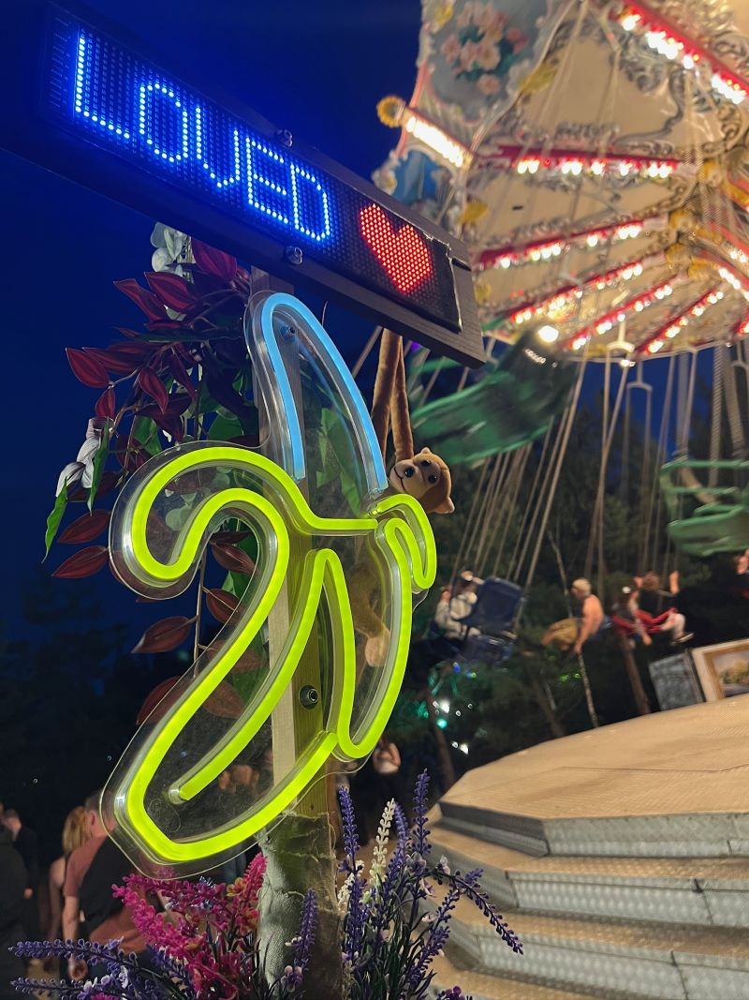

<h1 align="center">🍌 RavestickBoard for CoolLEDX / CoolLED1248</h1>

<strong>Offline-Webcontroller für die 64 × 16-Pixel-CoolLEDX-Tafel mit ESP32-C3.</strong> 
Entstanden aus einer Festival-Banane und dem Wunsch, mehr aus der ursprünglichen CoolLED1248-App herauszuholen.

> **Aktueller Entwicklungskandidat: v0.6.1.1-dev (3.11.2026).** *Behebt den Arduino-Compile-Fehler von 0.6.1.0* (`rb42ProgramPlaying` in `RavestickBoard_Anim.h` war dort noch nicht deklariert; siehe unten), sonst gleich 0.6.1.0. *Animationen als eigener Bereich:* Im Menü gibt es jetzt **Animationen**. Dort werden GIFs, Bildstreifen oder ein Text-Raster (Buchstaben `.RGBCMYW`, zum Beispiel aus Excel) im Browser auf 64 × 16 Pixel und die sieben LED-Farben gebracht, als Datei im ESP32 gespeichert und per Knopf als gespeicherte Animation (Befehl `0x04`) an die Tafel gesendet. Der Hardwaretest von 0.6.0.2 hat gezeigt: Die Tafel nimmt `0x04` an, Farben, Nummern und Laufrichtung stimmen, 1/2/3/8 ms laufen flüssig, die Animation bleibt nach dem Ausschalten der Tafel erhalten und ein späterer Text ersetzt sie sauber. **Neu gebaut und nicht geprüft** sind: der Arduino-Compile (neue Datei `RavestickBoard_Anim.h`), alle Dateifunktionen auf dem echten ESP32 (LittleFS, Webserver), das Senden einer gespeicherten Animation über BLE (79 Bilder dauern rund 55 s), und die Weboberfläche auf iPhone und iPad. Der Tempo-Regler ist, solange eine Animation auf der Tafel liegt, gesperrt (er wirkt dort nicht). Der Animationsversand **ersetzt den Inhalt der Tafel**. Darunter unverändert 0.5.0.1 (Tafelverwaltung) und der Animationstest in den Einstellungen. Vollständige Versionsgeschichte: [`CHANGELOG.md`](CHANGELOG.md), Kurzüberblick: [`VERSIONSGESCHICHTE.md`](VERSIONSGESCHICHTE.md), Testschritte: [`docs/TESTPLAN_v0.6.1.1.md`](docs/TESTPLAN_v0.6.1.1.md).

## Was ist RavestickBoard?

Das iPhone oder ein anderer Browser verbindet sich mit dem WLAN `CoolLED1248` des **ESP32-C3 Super Mini**. Das lokale Webinterface unter **http://192.168.4.1** überträgt die Darstellung via Bluetooth Low Energy (FFF0/FFF1) an die **CoolLEDX-Tafel**. Die LED-Tafel benötigt keine modifizierte Herstellerfirmware und kann einmal hochgeladene Inhalte autonom wiederholen. Die Bedienoberfläche läuft ohne Internetzugang; USB bleibt der einzige Firmware-Updateweg, **kein OTA**.

**Was die Oberfläche kann:**

- **Kurzwahl:** acht frei belegbare Kacheln (Bibliothekseinträge, Programme, Ambiente) für den schnellen Zugriff auf der Veranstaltung.
- **Lauftext:** Original-Schriften (Normal, Fett), Engschrift und Mini (ein- oder zweizeilig), 24 Herstellersymbole plus eigene Motive, Live-Vorschau und Datenbudget. Farbe und Schrift lassen sich pro Zeichen gestalten.
- **Animationen (Menü, seit 0.6.1.0):** eigener Bereich, getrennt von Lauftext, Seiten und Programmen. Import von GIF, Bildstreifen und Text-Raster (`.RGBCMYW`), Anpassen (Ausschnitt, Skalierung, Farbreduktion auf sieben LED-Farben, Bildauswahl, Zeit je Bild), Vorschau, Speichern im ESP32 (bis zu 40 Animationen, je höchstens 79 Bilder), Senden an die Tafel, Umbenennen, Duplizieren, Löschen. Die Tafel speichert und spielt die Animation selbst.
- **Animationstest (Einstellungen, seit 0.6.0.0):** sendet eingebaute Testmuster (Frame-Nummern, Vollbildfarben, Balken) als gespeicherte Animation (Befehl `0x04`) und zeigt die Antwortcodes der Tafel in der Diagnose. Bleibt als Prüfwerkzeug erhalten; die Muster sind auch Vorlage für spätere Zähler- oder Uhrzeit-Anzeigen (Zukunftsmusik, siehe Themenspeicher).
- **Tafelverwaltung (Einstellungen):** Tafeln suchen (Trefferliste mit Signalstärke), „Meine Tafel“ im ESP32 speichern, eine fremde Tafel vorübergehend nutzen und per Knopf zurückwechseln. Die Einstellungen zeigen, ob „Meine Tafel“, eine fremde Tafel oder keine Tafel aktiv ist.
- **Blockseiten:** feste Seiten mit Ausrichtung und Anzeigedauer, als Blockfolge sendbar. Farbe und Schrift lassen sich auch hier pro Zeichen gestalten.
- **Bibliothek und Programme:** Einträge speichern, benennen, duplizieren, sortieren; Programme spielen Einträge nacheinander ab (Original oder als gemeinsames Laufband).
- **Tafelsteuerung:** Helligkeit, Tempo und Anzeige an/aus stehen unten auf jeder Seite; die Tasten zum Erzwingen eines Anzeigeverhaltens auf allen Seiten außer der Kurzwahl, wo nur Linkslauf, Standbild und der Stift zum Bearbeiten bleiben.
- **Diagnose:** RAM-Messung, HTTP-Spur, Absturzspur nach Hänger, Export als Textdatei.

## Aktuell: v0.6.1.1-dev – Animationen: Import und Liste (aufbauend auf 0.6.0.2 und 0.5.0.1)

- **Neu in 0.6.1.1** (Rückmeldung aus dem ersten Compile von 0.6.1.0): Der Sketch ließ sich nicht übersetzen, einziger Fehler: `'rb42ProgramPlaying' was not declared in this scope` in `RavestickBoard_Anim.h` (Zeile 411, in `onAnimSend`). Ursache: Ich hatte `RavestickBoard_Anim.h` direkt hinter `RavestickBoard_Library.h` eingebunden, die Variable `rb42ProgramPlaying` steht aber in `RavestickBoard_v042.h`, das erst weiter unten eingebunden wird. Die Einbindung steht jetzt hinter `RavestickBoard_v042.h`. Außerdem ist die unbenutzte Funktion `rb61CountAnims()` entfernt (Compiler-Warnung). **Sonst ist der Stand gleich 0.6.1.0.** Neu im Test: `tests/decl_order.py` setzt den Sketch mit seinen `.h`-Dateien in Include-Reihenfolge zusammen und meldet jeden Namen, der vor seiner ersten Deklaration benutzt wird; er findet den Fehler der Fassung 0.6.1.0 und nichts in 0.6.1.1. Das ersetzt keinen Compile (Näherung ohne Präprozessor), ist aber die zweite Prüfung dieser Art nach `arduino_prototypes.py`: Meine Rechnertests übersetzen nur Ausschnitte des Sketchs und konnten diesen Fehler nicht sehen. Weitere Compile-Fehler sind nicht ausgeschlossen; das Log von 0.6.1.0 enthielt außer diesem Fehler keinen weiteren, der Linker lief aber noch nicht.
- **Hardwaretest von 0.6.0.2 (deine Rückmeldung):** Farbreihenfolge (blau, grün, cyan, rot, magenta, gelb, weiß), lesbare Nummern und Balkenrichtung stimmen. Die Auswahl „Anzeigemodus danach“ (`0x06`) bewirkt nach dem Upload **nichts**. 1, 2, 3 und 8 ms je Bild laufen flüssig. Die Animation **bleibt nach dem Aus- und Einschalten der Tafel**. Ein späterer Text ersetzt sie sauber. Der **Tempo-Regler wirkt nicht auf Animationen**. Offen aus diesem Test: Wirkung des Helligkeitsreglers auf Animationen; die Grenzfälle 79 und 80 Bilder müssen wiederholt werden (der Versuch mit 80 Bildern kam wegen eines BLE-Verbindungshängers mit Wächter-Neustart nicht bis zur Tafel).
- **Neu in 0.6.1.0:**
  - **Menüpunkt „Animationen“** (Lucide-Symbol `film`). Die Liste zeigt je Animation eine Miniatur (erstes Bild), Name, Bildzahl und Zeit je Bild; beim Auswählen lädt die Oberfläche die Animation vom ESP32 und spielt sie in der Vorschau ab. Aktionen: Senden, Umbenennen, Duplizieren, Löschen. Beschädigte Dateien erscheinen als solche in der Liste (und zählen mit), damit sie sich löschen lassen.
  - **Import (alles im Browser):** *GIF* (eigener Decoder: Interlace, Teilbilder, Transparenz, Entsorgungsarten, Zeitangaben; am Rechner gegen den GIF-Decoder von Chromium geprüft, bis zu 300 Quellbilder), *Bildstreifen* (ein Bild mit mehreren Bildern nebeneinander oder untereinander) und *Text-Raster* (ein Buchstabe aus `.RGBCMYW` je Pixel; Zellen aus Excel (Tabulator-getrennt) oder direkt aneinandergeschrieben; leere Zeile oder `---` trennt die Bilder; 64 × 16 Zeichen entsprechen 1:1 der Tafel, andere Größen werden eingepasst).
  - **Anpassen:** Einpassen (komplett sichtbar, ausfüllen, strecken, Originalgröße) mit Verschieben, Farbreduktion auf die sieben LED-Farben (Schwelle, Floyd-Steinberg, Bayer; Schwellwert und Kontrast), Bildbereich, Schrittweite, Hin- und Zurück, Zeit je Bild (1 bis 2000 ms), wiederholte Bilder zum Halten. Mehr als 79 Bilder werden gemeldet; „Auf 79 Bilder verteilen“ wählt gleichmäßig aus.
  - **Speichern im ESP32:** Dateien `/rb-anim/a<ID>.rba` im Dateisystem der Bibliothek (LittleFS), 448 Byte Kopf (mit Vorschaubild) plus die Nutzlast, genau wie sie an die Tafel geht. Das Hochladen geschieht in Stücken zu 1200 Byte (Base64) in eine Zwischendatei, die am Ende umbenannt wird. Höchstens 40 Animationen; es bleibt eine Reserve von 24 KiB frei. Das **Dateisystem muss eingerichtet sein** (Bibliothek). Das Bibliotheksformat ist unverändert.
  - **Senden aus der Datei:** Die Firmware liest die Nutzlast beim Senden stückweise aus der Datei (kein Gesamtpuffer). Das Senden läuft als Auftrag wie der Animationstest: kein Tempo- und kein Modusbefehl vorab oder danach, strikte Auswertung der Antwortcodes. Dauer bei 79 Bildern etwa 55 s (Adam: 0,2 s je Paket); die Importansicht zeigt eine Schätzung der Übertragungsdauer.
  - **Tempo-Regler gesperrt, solange eine Animation läuft:** `/api/status` meldet `animActive`; nach dem Senden einer Animation ist der Regler gesperrt, nach Text, Seite, Band oder Ambiente wieder frei. Nach einem Neustart des ESP32 ist der Zustand unbekannt, der Regler bleibt dann bedienbar.
  - **Entfallen:** die Auswahl „Anzeigemodus danach“ im Animationstest (ohne Wirkung); die Firmware sendet nach Animationen keinen `0x06`.
  - **Die Testmuster bleiben:** Der Animationstest bleibt in den Einstellungen; die einzelnen Bilder (Nummern, Vollbildfarbe mit Nummer, Balken) sollen später für Zähler oder Uhrzeit nutzbar bleiben.
  - **Nicht enthalten:** Zeichen-Editor (0.6.2.0), Komfortfunktionen (0.6.3.0), Animationen als Kurzwahl (0.6.1.2), Animationen in Programmen.
  - **Entwicklungsschalter:** `RB_TEST_HANG` bleibt in diesem Stand auf 1.
  - **Geprüft (ohne Arduino/Hardware):** Dateispeicher mit dem echten Sketch-Code gegen ein Dateisystem im Speicher (Upload in Stücken, Liste, Abruf, Senden aus Datei, Umbenennen, Duplizieren, Löschen, Grenzen: 40 Animationen, 79 Bilder, Speicher voll, Schreibfehler, beschädigte Dateien); Nutzlast gegen die unabhängige Referenz, die schon die Firmware von 0.6.0.2 bestätigt hat (auf der Tafel richtig); GIF-Decoder, Raster- und Streifenimport, Farbumsetzung und Planung in Node; Weboberfläche in Chromium mit simulierter API (auch bei 390 px Breite ohne Zoom). **Nicht geprüft:** Arduino-Compile (insbesondere die Dateifunktionen des Cores 3.3.12), echtes LittleFS und Webserver mit 1,6-KB-Anfragen und ~40-KB-Abruf, das echte Senden über BLE aus der Datei, Speicher (Heap) mit zwei Geräten während des Sendens, iPhone/iPad-Safari (Dekodiergeschwindigkeit großer GIFs), Wirkung der Helligkeit auf Animationen.

- **Frühere Stände (unverändert, zur Einordnung):**
  - Animationstest mit Frame-Nummer (0.6.0.0 bis 0.6.0.2, aufbauend auf 0.5.0.1: Tafelverwaltung).

- **Neu in 0.6.0.2** (Rückmeldung aus dem ersten Compile von 0.6.0.1): Der Sketch ließ sich nicht übersetzen (`'RamStage' was not declared in this scope` bei `ramStageLabel` und `ramTraceMark`, Folgefehler an allen Aufrufstellen). Ursache: Ich hatte die Animationsfunktionen **vor** `enum RamStage` in die Datei gesetzt. Die Arduino-IDE erzeugt die Funktionsprototypen automatisch und setzt sie vor die erste Funktionsdefinition; dort kannte der Prototyp von `ramStageLabel(RamStage)` den Typ noch nicht. Die Funktionen stehen jetzt hinter den Typdefinitionen und hinter `rbPhase()`, Konstanten und Variablen der Animation bleiben oben. **Sonst ist der Stand gleich 0.6.0.1.** Neu im Test: `tests/arduino_prototypes.py` bildet diese Regel nach (kein selbstdefinierter Typ in einer Funktionssignatur vor der ersten Funktion); der Test erkennt die Fassung 0.6.0.1 als fehlerhaft und die kompilierte 0.5.0.1 als in Ordnung. Das ersetzt keinen Compile: weitere Fehler dieser Art sind nicht ausgeschlossen.

- **Neu in 0.6.0.1** (Vorschlag aus der Planung des Hardwaretests; 0.6.0.0 wurde nicht geflasht, 0.6.0.1 ließ sich nicht kompilieren):
  - **Frame-Nummer:** Jedes Frame der Testmuster zeigt seine Nummer, zweistellig und 1-basiert (01, 02 …), mit eigenen 3×5-Ziffern in doppelter Größe in der Mitte (14 × 10 Pixel). So sieht man bei 79 Frames, wie viele ankommen, wo die Schleife endet und ob die Reihenfolge stimmt. Farben: schwarz auf der Farbfläche, grün über dem Balken, weiß im Grenztest.
  - **Grenztest:** Standardzeit jetzt 300 ms (zuvor 40 ms), damit die Nummer lesbar ist; ein Durchlauf mit 79 Frames dauert etwa 24 s. Die Balkenfarbe wechselt alle 8 Frames durch sechs Farben ohne Weiß (Weiß ist der Nummer vorbehalten). Zum Lesen der Nummer sind etwa 300 ms oder mehr nötig; mit kürzeren Zeiten bleibt die Prüfung der Geschwindigkeit möglich.
  - **Sonst unverändert gegenüber 0.6.0.0**, siehe unten.
- **Neu in 0.6.0.0:**
  - **Animationstest (Einstellungen, ganz unten):** Vier Tasten senden ein eingebautes Muster als **gespeicherte Animation** an die Tafel: *Farben* (7 Frames, je eine der sieben LED-Farben, 700 ms), *Balken* (16 Frames, wandert von links nach rechts, 60 ms; oben links ein roter, unten rechts ein blauer Eckpixel zur Orientierung), *Grenze: 79 Frames* (in 0.6.0.0 noch 40 ms, ab 0.6.0.1 300 ms) und *80 Frames* (absichtlich zu groß, die Tafel soll mit einem Fehlercode ablehnen). Zwei Felder: Zeit je Frame in ms (1–2000, leer = Standard des Musters) und Anzeigemodus danach (unverändert lassen / statisch `0x01` / Lauftext `0x02`).
  - **Warum 79?** Die Tafel nimmt höchstens etwa 30 KiB: 27 Byte Kopf + Frames × 384 Byte. 79 Frames ergeben 30 363 B, 80 Frames 30 747 B (über 30 720 B). Die Grenze stammt aus Adams Messung an seiner Tafel (OpenSign) und ist an deiner Tafel noch nicht gemessen; genau das soll der Test klären.
  - **Antwortcodes der Tafel:** Zu jedem Datenpaket schickt die Tafel eine Antwort mit einem Statuswert (0 in Ordnung, 6 Prüfsummenfehler, 1–5 Fehler). Die Firmware liest sie jetzt aus und zählt sie in der Diagnose (in Ordnung / Prüfsummenfehler / Fehlercodes / nicht lesbar). Nur beim Animationstest ist ein Wert ungleich 0 ein Fehler: bei 6 wird das Paket bis zu zweimal neu gesendet, bei 1–5 bricht der Auftrag mit der Meldung „Tafel lehnt Paket n von m ab: Code 0x.. (Text)“ ab. **Alle anderen Aufträge (Text, Seiten, Blockfolge, Ambiente) verhalten sich unverändert**, sie zählen und protokollieren die Codes nur.
  - **Tempo:** Bei Animationen gilt die Zeit je Frame in Millisekunden (kleiner = schneller). Das ist das Gegenteil des Lauftext-Tempos (`0x07`). Es gibt ein globales Tempo je Animation, keine Zeit pro Frame; Halten geschieht durch wiederholte Frames. Die Tafel speichert und wiederholt die Animation selbst.
  - **Nicht enthalten (in 0.6.0.0; GIF-Import und Animationsliste kamen mit 0.6.1.0):** GIF-Import, Zeichnen, Animationsliste. Das war für 0.6.1.0 (Import und Bibliothek), 0.6.2.0 (Zeichen-Editor) und 0.6.3.0 (Komfort) geplant, siehe [`docs/ROADMAP.md`](docs/ROADMAP.md). Animationen sind dabei ein eigener Bereich, getrennt von Lauftext, Seiten, Programmen und Effekten.
  - **Entwicklungsschalter:** `RB_TEST_HANG` bleibt in diesem Stand auf 1.
  - **Geprüft (ohne Arduino/Hardware):** Der Nutzdatenstrom der Animation wird am Rechner mit dem echten Sketch-Code erzeugt und gegen eine unabhängige Rechnung geprüft (Kopf, Ebenenreihenfolge, Spaltenbyte, Chunk-Kopf, Prüfsumme, Paketrahmen, 79 Frames passen, 80 nicht); der Antwort-Parser wurde gegen 2 979 echte Antworten aus einem fremden Protokoll (alle Status 0) und synthetische Fehlerfälle geprüft. **Nicht geprüft:** Arduino-Compile, ob deine Tafel `0x04` annimmt, wie `0x06` danach wirkt, Verhalten nach dem Ausschalten, der Prüfsummen-Wiederholungspfad.
- **Neu in 0.5.0.1 (unverändert, Hardwaretest bestanden):** Der Chip „Meine Tafel/Fremde Tafel/Keine Tafel“ neben dem Bluetooth-Zeichen entfällt auf Wunsch. Sonst ist der Stand gleich 0.5.0.0 (Firmware unverändert bis auf die Version).

- **Neu in 0.5.0.0:**
  - **Meine Tafel im ESP32 statt im Code:** Es wird keine Tafeladresse mehr mitgeliefert. Beim ersten Start (und nach dem Update von 0.4.x) ist keine Tafel eingerichtet; Senden meldet „Keine Tafel eingerichtet“. Unter **Einstellungen → LED-Tafel** auf „Tafel suchen“ tippen (dauert etwa 4 s, die Oberfläche antwortet währenddessen nicht), in der Trefferliste „Als meine Tafel speichern“ wählen. Die Tafel bleibt auch nach einem Neustart erhalten (NVS, Namespace `rbsign`). Speichern ersetzt die bisherige Tafel; dafür ist ein zweiter Tipp nötig, Löschen ist nicht vorgesehen.
  - **Fremde Tafel:** „Jetzt nutzen“ schaltet vorübergehend auf eine andere Tafel (zum Beispiel zur Vorführung bei einer anderen Crew), gespeichert wird nichts. „Zurück zu meiner Tafel“ wechselt ohne neue Suche zurück; nach einem Neustart des ESP32 ist wieder Meine Tafel aktiv. Es wird immer nur an eine Tafel gesendet.
  - **Trefferliste:** Tafeln zuerst (Name enthält „cool“, wirbt mit dem Dienst FFF0 oder ist Meine Tafel), danach nach Signalstärke, mit den Lucide-Symbolen `signal` (≥ −60 dBm), `signal-high`, `signal-medium`, `signal-low` und `signal-zero` (< −90 dBm); `antenna` für die Suche. „Alle Bluetooth-Geräte zeigen“ blendet zusätzlich fremde Geräte ein, falls die Tafel ihren Namen nicht mitsendet.
  - **Anzeige:** In 0.5.0.0 stand neben dem Bluetooth-Zeichen im Seitenkopf ein Chip „Meine Tafel/Fremde Tafel/Keine Tafel“; er ist ab 0.5.0.1 entfallen. Die aktive Tafel steht in den Einstellungen.
  - **Kleinigkeiten (Rückmeldung zu 0.4.6.0):** Die Palettentaste der Blockanzeige steht in derselben Zeile wie die Farben. Zoom ist gesperrt (Viewport, `touch-action: manipulation`, Spreizgesten unterdrückt, Eingabefelder mit 16 px). Die Listen von Programmen und Bibliothek enden oberhalb des Bedienfelds, die Seite scrollt nicht mehr bis dorthin.
- **Neu in 0.4.6.0:**
  - **Zeichen gestalten auch für Blockseiten:** In der Blockanzeige öffnet die Palettentaste unter „Farbe · Zeile 1“ dasselbe Fenster wie beim Lauftext. Zeichen markieren, Farbe und Schrift setzen; Rückgängig/Wiederherstellen gelten im Fenster (je Seite, beim Seitenwechsel beginnt der Verlauf neu). „Senden“ im Fenster zeigt die Seite auf der Tafel. Bei Mini zweizeilig gelten Farben pro Zeichen und Zeile, Schriftwechsel nicht. Was über 64 Pixel hinausragt, ist wie bisher nicht erlaubt; die Seite meldet die Breite.
  - **Firmware:** Die Seitendarstellung versteht die Stilmarken (gleiche Zeichen- und Messregeln wie beim Lauftext). Seiten ohne Marken werden unverändert gezeichnet (am Rechner Pixel für Pixel gegen den alten Weg geprüft). **Jede Marke belegt 2 der 47 Bytes pro Zeile**; bei sehr vielen Wechseln meldet der Editor, dass die Zeile zu lang ist.
  - **Bluetooth-Zeichen:** Nach dem Annehmen eines Auftrags zeigt es zuerst „sucht“ (`bluetooth-searching`); schweigt der ESP danach länger als 3,5 s (Vor-Scan höchstens 3 s), wird `bluetooth-connected` gezeigt, bis die erste Antwort den echten Zustand liefert. Das ist ein Schluss aus dem Schweigen, keine Messung.

- **Zeichen gestalten (seit 0.4.4.0):** Im Lauftext-Editor öffnet die Palettentaste ein Fenster. Zeichen einzeln antippen oder per Wischen auswählen, dann Farbe und Schrift (Normal, Fett, Engschrift, Mini) für die Auswahl setzen. „Farbwechsel“ färbt reihum pro Zeichen oder pro Wort. Bei Zweizeilig Mini gehen Farben pro Zeichen und Zeile.
- **Neu in 0.4.5.1** (Auswertung des Serial-Monitors von 0.4.5.0):
  - **Vor-Scan:** Vor jedem *neuen* Verbindungsaufbau lauscht der ESP bis zu 3 s passiv nach der Tafel und bricht beim Treffer sofort ab. Wird die Tafel nicht gehört, aber andere Bluetooth-Geräte, gibt es keinen Verbindungsversuch und die Meldung „LED-Tafel nicht gefunden“. Hört der Scan gar nichts, verbindet die Firmware wie bisher. Hintergrund: Mit ausgeschalteter Tafel kehrte `connect()` nicht rechtzeitig zurück, der Hang-Wächter hat nach 25 s neu gestartet. Abschaltbar mit `RB_PRESCAN 0`. Ist die Tafel mit der Original-App verbunden, wirbt sie nicht und wird nicht gefunden.
  - **Bluetooth-Zeichen im Seitenkopf:** `bluetooth` (kein Verbindungsversuch bzw. zuletzt erreicht, dann grün), `bluetooth-searching` (Auftrag läuft), `bluetooth-connected` (Verbindung steht), `bluetooth-off` (zuletzt nicht erreicht). Während einer Übertragung antwortet der ESP nicht; es bleibt der zuletzt gemeldete Zustand stehen.
  - **Diagnose:** Zähler und Dauer der Vor-Scans (mit Signalstärke); ein Heap-Tiefstand außerhalb von Anfragen nennt jetzt die zuletzt beendete Anfrage, den Abstand dazu und das Minimum davor.
  - **Übergang:** Die Adresse der Tafel steht noch fest im Code. Geplant (0.5.0.0): „Meine Tafel“ wird im ESP gespeichert und per Suche eingerichtet, es wird keine Adresse mehr mitgeliefert; zusätzlich Wechsel auf eine fremde Tafel mit Rückweg.
- **Neu in 0.4.5.0** (Rückmeldungen aus dem Test von 0.4.4.2):
  - **Höchstens zwei WLAN-Geräte:** `RB_AP_MAX_CLIENTS` steht jetzt auf 2 (zuvor 4). Das ist festgelegt, mehr Geräte sind nicht vorgesehen; ein drittes Gerät wird vom Access Point abgewiesen. Grund: Das dritte Gerät hat in 0.4.4.2 das System-Minimum des Heaps auf 3288 B gedrückt. Die Tafel zählt nicht mit, sie hängt per BLE.
  - **Zeichen-Fenster (Lauftext):** Waagerecht wischen markiert (auf Markiertem entmarkiert), senkrecht wischen scrollt. Der Umschalter Einzeln/Wischen entfällt. Doppeltipp markiert ein ganzes Wort (Satzzeichen am Rand bleiben außen), nochmal entmarkiert es. Vorschau und Werkzeugleiste stehen oben fest und werden beim Scrollen kleiner. Unten hält eine schmale Farbleiste, solange der große Farbblock nicht im Bild ist; die Schriften stehen nur im großen Block.
  - **Vorschau im Editor** (Lauftext und Blockanzeige) wird beim Scrollen kleiner; die Vorschau-Werkzeuge des Lauftexts erscheinen nur ganz oben.
  - **Kurzwahl-Dialog:** Quelle als Schaltflächen mit den Icons der Menüführung (Bibliothek, Programme, Ambiente; Animationen ausgegraut). Die Beschriftung wird mit dem Namen des Inhalts vorbelegt; bleibt sie unverändert, folgt die Kachel weiter dem Namen.
  - **Kleinigkeiten:** Startbildschirm-Bedienfeld mit fünf gleichmäßig verteilten Tasten (an, aus, Linkslauf, Standbild, Bearbeiten); Einstellungen und Diagnose: Backup- und Download-Knöpfe in der Designlinie mit Icons; ein zweiter Tipp auf einen gewählten Eintrag in Bibliothek und Programmen hebt die Auswahl auf.
- **Neu in 0.4.4.2** (Rückmeldung aus dem Test von 0.4.4.1, nur Weboberfläche, Firmware unverändert):
  - **Startbildschirm:** Das untere Bedienfeld zeigt nur noch *an, aus*, *Linkslauf* (Chevron links), *Standbild/Blocktext* (Achteck) und *Bearbeiten* (Stift), mit etwas Platz zwischen den Gruppen. Alle anderen Seiten behalten die volle Steuerung.
  - **Sortieren sofort:** In Bibliothek und Programmen springt der Eintrag beim Tippen auf den Pfeil sofort an die neue Stelle; die Befehle gehen der Reihe nach im Hintergrund an den ESP32. Nur bei einem Fehler wird die Liste vom ESP32 neu geholt.
  - **Weniger Last auf dem ESP32:** Seitenwechsel holen Bibliothek und Programme nur noch neu, wenn die Daten älter als 60 s sind (sonst Anzeige aus dem Speicher). Beim Start erscheint die Oberfläche zuerst, die Listen laden danach im Hintergrund. Die Statusabfrage pausiert, solange der ESP32 mit einer Anfrage beschäftigt ist oder der Tab im Hintergrund liegt.
- **Neu in 0.4.4.1:**
  - **Wischen entmarkiert:** Beginnt der Wisch auf einem markierten Zeichen, entmarkiert er alles, was er überstreicht; sonst markiert er.
  - **Schrift direkt wählen:** Die vier Schriften sind einzeln antippbar, der große Durchschalter entfällt.
  - **Rückgängig und Wiederherstellen** (nur Icons, neben „Text leeren“) für den ganzen Lauftext-Editor: Text, Zeichenstile und Zeilenfarben, mehrstufig. Der Knopf „Stil rückgängig“ entfällt.
  - **Größeres Eingabefeld (nur Lauftext):** wächst mit dem Text mit und lässt sich am Griff darunter nach unten größer ziehen (Doppelklick auf den Griff stellt wieder auf automatisch; auf dem iPhone noch ungeprüft). Die Eingabetaste schließt die Tastatur, statt einen Umbruch einzufügen.
  - **Programme sortieren:** Pfeile hoch/runter wie in der Bibliothek. Die Reihenfolge liegt auf dem ESP32 und gilt für alle Geräte (neue Firmware-Route `/api/collections/move`, Datei `/rb-lib/porder.bin`).
  - **Startbildschirm:** zeigt wieder dieselbe Tafelsteuerung wie alle anderen Seiten, inklusive der Tasten zum Erzwingen eines Anzeigeverhaltens und dem Stift für die Kurzwahlen.
- **Technik:** Die Gestaltung reist als unsichtbare Steuerzeichen im Text (U+0090..U+009C, Format in [`docs/TECHNIK.md`](docs/TECHNIK.md)). Die Firmware wertet sie beim Zeichnen aus, daher wirken sie auch in Bibliothek, Programmen und Gruppen. Einträge ohne Marken bleiben unverändert gültig; ältere Firmware kennt die Marken nicht (Darstellung dort ungeprüft).
- **Entwicklungsschalter:** `RB_TEST_HANG` steht in diesem Stand noch auf 1 (Test-Auslöser `/api/test/hang` für den Wiederanlauftest). Für eine Freigabe auf 0 setzen.
- **Bekannt:** Die Gesten im Zeichen-Fenster (Richtungserkennung, Doppeltipp ohne Zoom) sind nur im simulierten Chromium geprüft, nicht auf dem iPhone. Die Bibliotheksliste braucht auf dem ESP32 etwa 0,9 s, weil jeder Eintrag vollständig gelesen und geprüft wird; währenddessen bedient der Webserver nichts anderes. Eine Firmware-Beschleunigung ist offen. Der seltene BLE-Hänger (Diagnose: Phase `ble_regNotify`, Wächter-Neustart) und der niedrige Heap-Tiefstwert bleiben ungelöst.
- **Noch offen:** Hardwaretest von 0.6.1.1 (Animationen speichern, auflisten, senden; Wirkung der Helligkeit; 79 und 80 Bilder), danach Animationen als Kurzwahl (0.6.1.2), Zeichen-Editor mit Stift (0.6.2.0), Komfortfunktionen (0.6.3.0); Arduino-Compile, Wiederanlauf- und Zwei-Geräte-Test (siehe [`docs/ROADMAP.md`](docs/ROADMAP.md)).

## Kurz zurückgeblickt

- **v0.6.1.1-dev:** Compile-Fehler von 0.6.1.0 behoben (Einbindung von `RavestickBoard_Anim.h` hinter `RavestickBoard_v042.h`), neuer Test der Deklarationsreihenfolge.
- **v0.6.1.0-dev:** Animationen als eigener Bereich: Import (GIF, Bildstreifen, Text-Raster), Anpassen, Speichern im ESP32 (LittleFS), Liste, Senden aus der Datei, Tempo-Regler bei Animationen gesperrt, Anzeigemodus-Auswahl entfernt.
- **v0.6.0.2-dev:** Compile-Fehler von 0.6.0.1 behoben (Reihenfolge von Typen und Funktionen für die Arduino-Prototypen).
- **v0.6.0.1-dev:** Frame-Nummer in den Testmustern, Grenztest mit 300 ms.
- **v0.6.0.0-dev:** Animationstest (Befehl `0x04`) mit eingebauten Mustern, Antwortcodes der Tafel in der Diagnose.
- **v0.5.0.1-dev:** Kopfzeilen-Chip der Tafelverwaltung entfällt.
- **v0.5.0.0-dev:** Tafelverwaltung (Meine Tafel im ESP32, Suche, fremde Tafel mit Rückweg, keine Adresse mehr im Code), Zoom-Sperre, Palettentaste in der Farbzeile.
- **v0.4.6.0-dev:** Zeichen-Editor auch für Blockseiten, Bluetooth-Zeichen „verbunden“ während der Übertragung.
- **v0.4.5.1-dev:** Vor-Scan der Tafel und Bluetooth-Zeichen im Seitenkopf.
- **v0.4.5.0-dev:** Höchstens zwei WLAN-Geräte, Wischen im Zeichen-Fenster, Quellen-Schaltflächen im Kurzwahl-Dialog.
- **v0.4.4.2-dev:** Sortieren sofort, weniger Anfragen an den ESP32, schlankes Startbildschirm-Bedienfeld.
- **v0.4.4.1-dev:** Feinschliff des Zeichen-Editors, Rückgängig/Wiederherstellen, sortierbare Programme, wachsendes Eingabefeld.
- **v0.4.4.0-dev:** Erstfassung von „Zeichen gestalten“, einheitliche Sendefarbe (Mint) auf allen Senden-Knöpfen, etwas größere Regler.
- **v0.4.3.x-dev (Stabilitätsarbeit):** Nach einem Tafel-„ERROR“ im Blockband-Upload hing der ESP32 (die BLE-Bibliothek des Cores wartet an mehreren Stellen ohne Zeitlimit). Seitdem gibt es einen **Wächter**, der das Board nach 25 s ohne Lebenszeichen neu startet, eine **Absturzspur** im RTC-Speicher (Serial `[VORLAUF]`, Diagnose) und eine getrennte **RAM-Messung** beim Start. Der Wächter hat einen echten Hänger erkannt; danach war die Weboberfläche zunächst nicht erreichbar. Deshalb meldet der Wächter vor dem Neustart alle WLAN-Geräte ab (Vermutung, noch nicht bewiesen), und ein Test-Auslöser erlaubt es, den Wiederanlauf gezielt zu prüfen. Messreihen zeigten einen Einbruch des Heap-Minimums beim Beitritt eines zweiten WLAN-Clients (bis 192 B). Der Hänger selbst ist selten (94 Verbindungen am Stück ohne Fehler). **Keine belegte Behebung, nur Messkandidaten.**
- **v0.4.3-dev (UI-Konsolidierung):** Lauftext-Editor mit „Lauftext senden“ und „Speichern“ (Aktualisieren oder neue Variante), Blockanzeige mit Original-Normal als Standard und Seitenwerkzeugen, Programme im Bibliotheksstil mit eigener Bearbeitungsansicht, Lucide-Icons, App-Symbol und Favicon, Diagnose ohne Dauerlast (kompaktes JSON, TXT-Bericht nur auf Abruf).
- **v0.4.2.x-dev (HTTP- und RAM-Stabilisierung):** Weboberfläche per gzip, ETag und 304 ausgeliefert, JSON-Antworten in begrenzten Stücken, Lauftext-Gruppen mit kleinem 384-Byte-Tile-Puffer statt vollem 30-KiB-Bildpuffer, einmalige Wiederholung einer nicht bestätigten Gruppe nach BLE-Neuverbindung, Programme als Laufband mit vorsichtiger Laufzeitschätzung, gemeinsame untere Tafelsteuerung, acht Kurzwahlen, Bibliothek im LittleFS. Hardwaretests vom 28./29.10.2026 bestätigten Lauftexte, Symbole, Farben und kleine Laufbänder; ein späterer Upload scheiterte bei Paket 70/106 ([Testbefund](docs/TESTBEFUNDE_v0.4.2.3.md)). **Der historische Heap-Tiefstwert (zeitweise 592 Byte, auch mit nur einem Client) ist weiter nicht eindeutig geklärt.** Die A/B-Messungen dazu stehen in [`docs/VERGLEICHSTEST_v0.4.2.4.2.md`](docs/VERGLEICHSTEST_v0.4.2.4.2.md).

Die vollständige Geschichte steht in [`CHANGELOG.md`](CHANGELOG.md).

### Speichern und Mehrgerätebetrieb

Beim Bearbeiten eines vorhandenen Bibliothekseintrags wählt man nach **Speichern**, ob er **aktualisiert** oder als **neuer Eintrag** mit eigener ID gesichert wird. Die Vorlage und darauf verweisende Kurzwahlen und Programme bleiben bei der zweiten Option unverändert.

Bearbeitungen werden auf dem jeweiligen Gerät direkt in der Bibliothek angezeigt. Hat ein anderes Smartphone Änderungen vorgenommen, aktualisiert **Menü → Webinterface neu laden** die Ansicht (Bibliothek und Programme werden beim Seitenwechsel außerdem im Hintergrund aufgefrischt, wenn sie älter als 60 s sind); gleichzeitige Bearbeitung desselben Eintrags kann vorherige Änderungen überschreiben. Die Programmreihenfolge liegt auf dem ESP32 und ist damit für alle Geräte gleich.

## Installation und Datensicherheit

1. Vorab ein JSON-Backup aus der aktuell laufenden Firmware erstellen und lokal aufbewahren. Die bisherige Firmware als Rückfallversion sichern.
2. `firmware/RavestickBoard_v0_6_1_1/RavestickBoard_v0_6_1_1.ino` öffnen. **Alle sieben Dateien** im selben Sketch-Ordner belassen: `.ino`, `RavestickBoard_WebUI.h`, `RavestickBoard_Assets.h`, `RavestickBoard_Library.h`, `RavestickBoard_Anim.h` (neu in 0.6.1.0), `RavestickBoard_v042.h` und `RavestickBoard_Icon.h`.
3. Arduino IDE: **ESP32C3 Dev Module**, Espressif **3.3.12**, **USB CDC On Boot: Enabled**, **No OTA (2MB APP/2MB SPIFFS)**. Bestehendes Partitionsschema **nicht ändern**, **Erase All Flash deaktiviert** lassen.
4. Nach dem Flashen mit WLAN `CoolLED1248` verbinden, `http://192.168.4.1` aufrufen. Bibliothek nicht neu formatieren; das Bibliotheksformat ist unverändert. Für Animationen muss das Dateisystem eingerichtet sein (wie für die Bibliothek); der Ordner `/rb-anim` wird beim Start angelegt. Falls das Homescreen-Icon nicht übernommen wird, die Verknüpfung über Safari erneut hinzufügen.
5. Nach Änderungen an `web/index.html`: `python tools/sync_web.py` erzeugt den gzip-Webheader neu.

Weiterführend: [Bibliotheksformat](docs/BIBLIOTHEK_v0.4.1.md), [letzte ausführliche Installationsanleitung](docs/INSTALLATION_v0.4.2.4.1.md), [Testplan](docs/TESTPLAN_v0.4.2.4.1.md), [Changelog](CHANGELOG.md), [Roadmap](docs/ROADMAP.md) und [Themenspeicher](docs/THEMENSPEICHER.md).

**Teststand v0.6.1.1 (Tests mit Endung `0611`):** zusätzlich zu den unten genannten Prüfungen: `tests/decl_order.py` (von `test_build_0611.py` aufgerufen) prüft die Deklarationsreihenfolge des zusammengesetzten Sketchs; `tests/host_animfs_0611.py` übersetzt `RavestickBoard_Anim.h` mit dem echten Sketch-Code gegen ein Dateisystem im Speicher und prüft Upload in Stücken, Liste, Abruf, Senden aus der Datei, Umbenennen, Duplizieren, Löschen und die Grenzfälle (40 Animationen, 79 Bilder, voller Speicher, Schreibfehler, beschädigte Dateien, nicht eingerichtetes Dateisystem). `tests/test_anim_core_0611.py` prüft die Kernfunktionen der Weboberfläche in Node (Nutzlast gegen die unabhängige Referenz, Base64, GIF-Decoder gegen Pillow und den Decoder von Chromium, Raster, Streifen, Farbumsetzung, Planung). `tests/test_browser_anim_0611.py` bedient den Bereich „Animationen“ in Chromium mit simulierter API (Menü, Liste, drei Importwege, Anpassen, 79-Bilder-Grenze, Speichern, Senden, Umbenennen, Duplizieren, Löschen, beschädigte Einträge, gesperrter Tempo-Regler). `tests/test_build_0611.py` prüft zusätzlich Routen, Einbindung der neuen Datei, Statusfeld `animActive` und die Dokumentation. **Nicht geprüft:** Arduino-Gesamtcompile, echtes LittleFS und Webserver, Senden über BLE aus der Datei, Safari auf iPhone und iPad.

**Teststand v0.6.0.2 (Tests damals mit Endung `0602`; seit 0.6.0.0 gilt der Animationsteil):** zusätzlich zu den unten genannten Prüfungen: `tests/host_anim_0611.py` erzeugt den Nutzdatenstrom der Animation mit dem echten Sketch-Code am Rechner und prüft ihn gegen eine unabhängige Rechnung (Kopf, Ebenenreihenfolge, Spaltenbyte, Chunk-Kopf, Prüfsumme, Rahmen mit Escape, 79 Frames passen, 80 nicht) und die Frame-Nummer (Ziffern gegen eine Textvorlage, alle Muster, alle Frames) sowie den Antwort-Parser (auch gegen echte Antworten, wenn der Quelltext des OpenSign-Projekts per `OPENSIGN_SRC` angegeben wird; sonst übersprungen). Der Browser-Test deckt den Abschnitt „Animationstest“ ab (vier Tasten, Parameter, Fehleranzeige). **Nicht geprüft:** Arduino-Gesamtcompile, ob die Tafel `0x04` annimmt, Anzeige, Wirkung von `0x06` danach, Verhalten nach dem Ausschalten, Prüfsummen-Wiederholung.

**Teststand v0.5.0.1 (Tests damals mit Endung `0501`) und v0.5.0.0:** zusätzlich: Logik der Tafelverwaltung mit dem echten Sketch-Code gegen Attrappen der BLE-Klassen (Adresse prüfen, Namen säubern, Treffer sammeln, sortieren, auf zwölf Einträge begrenzen), Browser-Test der Einstellungen (Suche, Signalsymbole, Speichern mit zweitem Tipp beim Ersetzen, fremde Tafel, Zurück ohne neue Suche, Anzeige in den Einstellungen), der Zoom-Sperre, der Palettentaste und der Listenhöhen sowie ein Test, dass keine Tafeladresse mehr im Code steht. **Nicht geprüft:** Arduino-Gesamtcompile mit den neuen Aufrufen (`haveName`, `getName`, `haveServiceUUID`, `isAdvertisingService`, aktiver Scan), die echte Suche und alle Tafelwechsel an der Hardware, das Verhalten der Zoom-Sperre auf dem iPhone, die Pfade der sechs neuen Lucide-Symbole (aus dem Gedächtnis).

**Teststand v0.4.6.0:** zusätzlich zu den unten genannten Prüfungen: Seitendarstellung der Firmware am Rechner mit dem echten Sketch-Code (Seiten ohne Marken = alter Weg in 378 Fällen, Seiten mit Farb- und Schriftmarken gegen die Browser-Vorschau pixelgenau in 15 Fällen, Breitenmessung identisch), Browser-Test des Zeichen-Fensters für Blockseiten (Markieren, Farbe, Rückgängig/Wiederherstellen, Rundlauf, Prüfung der Breite und der 47 Bytes) und des Bluetooth-Zeichens während einer simulierten Übertragung. **Nicht geprüft:** Arduino-Gesamtcompile, Hardwaretest, Übertragung gestylter Seiten an die echte Tafel.

**Teststand v0.4.5.1:** zusätzlich zu den unten genannten Prüfungen: Entscheidungslogik des Vor-Scans mit dem echten Sketch-Code gegen Attrappen der BLE-Klassen (Treffer, nur fremde Geräte, nichts gehört) und Browser-Test des Bluetooth-Zeichens. Die echte BLE-Bibliothek des Arduino-Core ist hier nicht verfügbar; Signaturen von `BLEScan`/`BLEAdvertisedDeviceCallbacks` sind nicht gegen Core 3.3.x kompiliert.

**Teststand v0.4.5.0:** JavaScript-Syntax, Browser-Test der Oberfläche (inkl. echter Touch-Wischereignisse, Doppeltipp, sofortigem Sortieren mit absichtlich langsamem Mock-ESP und Fehlerfall) (Playwright/Chromium, mehrere Mobilgrößen), Versionierung, gzip-/ETag-Konsistenz und Firmware-Invarianten geprüft. Die Firmware-Zeichenfunktionen und die neue Programm-Reihenfolge wurden im Host-Build (g++) mit dem echten Sketch-Code kompiliert und getestet; die Zeichnung wurde pixelweise mit der Browser-Vorschau verglichen. **Kein Arduino-Gesamtcompile dieses Standes und keine Hardwareprüfung auf ESP32-C3 und Tafel.** Details: [`tests/README.md`](tests/README.md).

## Mitmachen und Sicherheit

Siehe [CONTRIBUTING.md](CONTRIBUTING.md), [SECURITY.md](SECURITY.md), [CODE_OF_CONDUCT.md](CODE_OF_CONDUCT.md) und unsere [Issue-Vorlagen](.github/ISSUE_TEMPLATE/).

## Wie wir entwickeln

Wir entwickeln RavestickBoard gemeinsam: Wir entwerfen, programmieren, dokumentieren und testen die Software im engen Austausch. Die realen ESP32-/CoolLEDX-Hardwaretests führen wir vor Ort durch; dabei unterstützen KI-gestützte Werkzeuge wie **ChatGPT und Claude** die Konzeption, Fehlersuche, Implementierung und Dokumentation. Wir unterscheiden ausdrücklich zwischen lokal geprüftem Code und hardwarebestätigten Funktionen.

## Entwicklung, Quellen und Lizenz

RavestickBoard ist eine eigenständige C++-/HTML-/JavaScript-Implementierung. Die Referenzen für die Animationsforschung sind [schulzad/coolled-sign-controller (OpenSign)](https://github.com/schulzad/coolled-sign-controller) (Protokoll und Kodierung des Befehls `0x04`), [jean-santos/coolled1248-rs](https://github.com/jean-santos/coolled1248-rs) und [zackmcmurrin-dev/coolledux-linux-uploader](https://github.com/zackmcmurrin-dev/coolledux-linux-uploader). Ergänzend dokumentieren wir den früh untersuchten [UpDryTwist/coolledx-driver](https://github.com/UpDryTwist/coolledx-driver) und [ohtaras/led](https://github.com/ohtaras/led). Die technischen Protokollfakten wurden für unsere Firmware eigenständig umgesetzt. Ob eine Datenformatvariante des anderen Panels auf unserer eigenen CoolLEDX funktioniert, ist separat zu prüfen.

**Danksagung:** Besonderer Dank an **Adam Schulz**, [OpenSign](https://github.com/schulzad/coolled-sign-controller), für den freundlichen Austausch und die technischen Hinweise zu nativer Animation (`0x04`) und BLE-Bestätigungen. Adam hat uns per E-Mail ausdrücklich erlaubt, seine Arbeit zu nutzen, zu verändern und zu portieren, und weitere Hinweise gegeben (Datenlimit, Ablauf der Bestätigungen, Zeit je Frame). Auf diesen Erkenntnissen und dem dokumentierten Format beruht der Animationstest ab 0.6.0.0. Der Code dafür ist **eigenständig geschrieben, kein OpenSign-Code wurde übernommen**; Nutzdaten und Paketierung wurden lokal gegen OpenSigns Kodierer abgeglichen (byte-identisch). OpenSign steht inzwischen unter der MIT-Lizenz (Copyright © 2026 Adam Schulz); bei einer späteren Codeübernahme bleibt der Hinweis zu erhalten, siehe [`docs/QUELLEN_UND_LIZENZEN.md`](docs/QUELLEN_UND_LIZENZEN.md).

**Lizenz und Drittmaterialien:** Unser selbst entwickelter RavestickBoard-Code steht unter der **[MIT-Lizenz](LICENSE)** (Copyright © 2026 du13500). Die Lizenz erlaubt ausdrücklich auch kommerzielle Nutzung, Bearbeitung und Weitergabe unter ihren Bedingungen. Das Projekt wird derzeit als privates Hobbyprojekt entwickelt; das schränkt die MIT-Rechte nicht ein. Eingebettete **Lucide-Icons** stehen unter ISC, ausgewählte von Feather abgeleitete Icons zusätzlich unter MIT. Ihre erforderlichen Copyright- und Lizenzhinweise stehen in [THIRD_PARTY_NOTICES.md](THIRD_PARTY_NOTICES.md). Fremde Originalmotive, Marken und sonstige Drittmaterialien werden durch unsere MIT-Lizenz nicht automatisch mitlizenziert.

<strong>Made for the rave, powered by a banana. 🍌</strong> Independent project, not affiliated with the CoolLED1248/CoolLEDX manufacturer.

